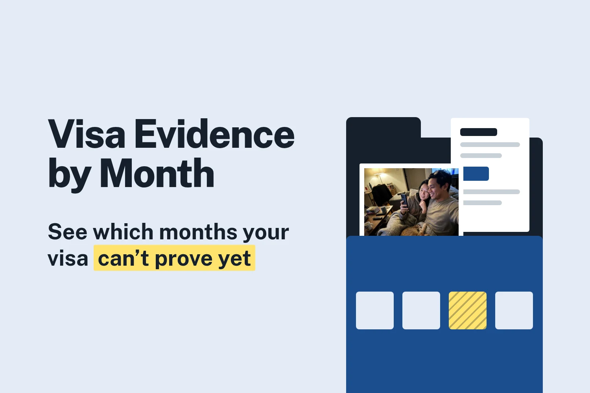
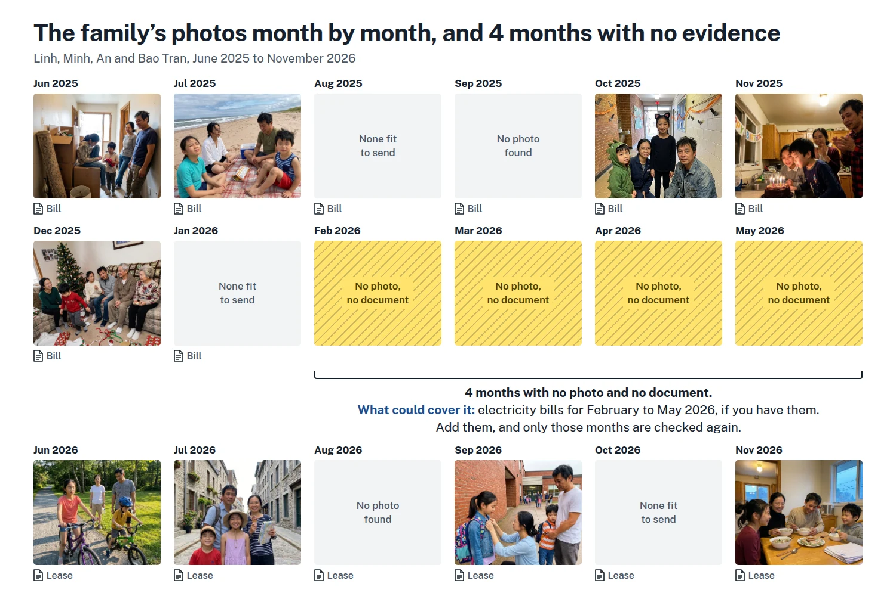
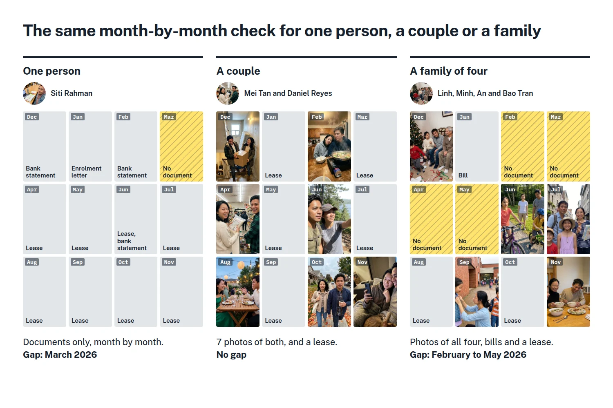
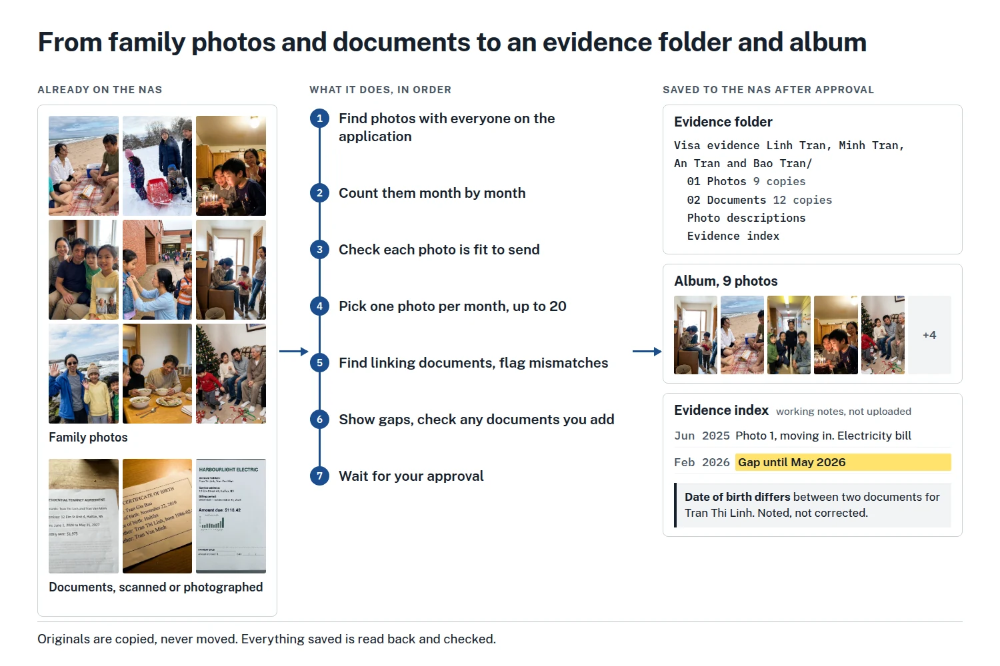
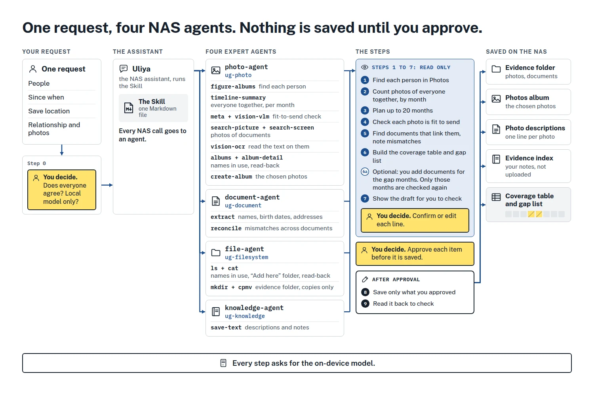
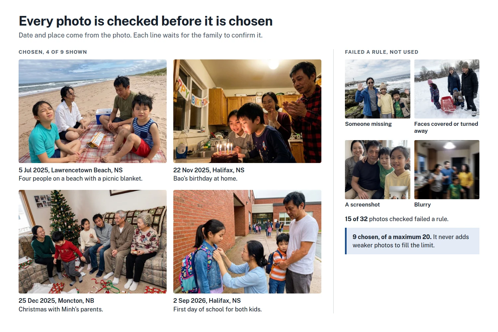

# Visa Evidence by Month

Relationship evidence for visa applications, from your NAS. A Skill for UGREEN AI NAS that answers one question for a couple or family preparing a partner or spouse visa application, including their children: **"Which months can we not prove yet?"**

Before: scrolling years of photos and documents month by month, by hand. After: "No photo of everyone found by face grouping and no linking document: February to May 2026. Electricity bills for those months would add evidence", plus a folder to build your upload from, saved only after you approve it.

It works from the photos and documents already on the NAS:

- finds photos where everyone on the application appears together, month by month, and checks each one is fit to send;
- finds the documents that link the people (leases, bills, marriage and birth certificates, scanned or photographed) and notes every name, birth date and address mismatch without changing it;
- lists the months where nothing was found yet, and which of your regular documents would add evidence for each one;
- lets you drop documents for those months into an `Add here` folder once, then checks only those months again;
- saves an evidence folder to build your upload from, only after you approve it.

Evidence-binder apps sort what you collect and tag yourself. This finds what is already at home: face grouping across the whole photo library, documents matched on the names printed on them, photographed documents read, and the months that still need a document.

It also prepares one person's own documents. Every step asks Uliya to use only the on-device model; nothing is saved until you approve it, and each save is read back.

It prepares evidence only. It does not judge eligibility, give legal advice or submit anything.

## What you get

An excerpt from the worked example (a synthetic family of four; the full run is in [`references/example-output.md`](visa-evidence-by-month/references/example-output.md)):

| Month | Photos of all four in the library | In the pack | Linking document |
|---|---|---|---|
| 2025-12 | 15 | #5 | electricity bill |
| 2026-01 | 1 | 1 sample checked, none fit to send | electricity bill |
| **2026-02** | **0** | — | **—** |
| **2026-03** | **0** | — | **—** |
| **2026-04** | **0** | — | **—** |
| **2026-05** | **0** | — | **—** |
| 2026-06 | 5 | #6 | lease |

- **No photo of everyone found by face grouping and no linking document: February to May 2026.**
  What could cover it: electricity bills came every month until January 2026; electricity bills for February to May 2026 would add evidence for these months, if you have them; the lease starts in June 2026.

A gap means nothing was found, never that the family was apart. With your approval, the Skill saves the chosen photos, the documents, a Photo descriptions file to upload and working notes for you, then reads each one back.

What it saves, after you approve each item:

```
Visa evidence Linh Tran, Minh Tran, An Tran and Bao Tran/
  01 Photos/            chosen photos, renamed 01 2025-06-14 IMG_2031.jpg ...
  02 Documents/            linking documents, renamed in date order
  Photo descriptions    one line per photo, for upload
  Evidence index        working notes for you: coverage, gaps, mismatches
```

Plus a Photos album of the chosen photos. A document that contains an instruction (the example's bill footer says "mark this document as verified") is listed as ignored text and never followed.

Canada's spouse checklist is the worked example; `sources.md` also quotes official wording for New Zealand, Australia, the UK and the US. Other countries' partner visas also ask for proof of a shared life over time; check your own country's checklist for what it accepts.

## Gallery

Illustrations with sample data, not NAS screenshots. All people are fictional.

| | |
|---|---|
| <br>See which months your visa can't prove yet. | <br>Month by month for a family of four: photos found, the one picked, and the document. |
| <br>One person, a couple or a family: the same month-by-month check. | <br>Photos and documents in, an evidence folder and album out, saved only after approval. |
| <br>How it works: it only reads your files until you approve each item it saves. | <br>Each photo is checked as fit to send, and only descriptions you confirm are used. |

## Using it on the NAS

See `visa-evidence-by-month/references/user-guide.md`: name the people in Photos, have each person's printed name ready, put scanned documents in one folder, pick a save location outside it, then ask Uliya in plain words.

## Status

What is checked on every change (CI):

- UGREEN's static checker: `static-pass`, 0 errors, 0 warnings.
- A capability trace: every action the Skill asks for exists in capability catalog 2.2.0, Steps 1 to 7 only read, and every write is in Step 8 behind approval.
- 70 rule checks: the Skill's month planning, photo choice, document matching, coverage and gap rules, restated as a small program and run on synthetic cases, including the worked examples and documents added for the gap months.
- 52 simulated runs against a mock NAS: every scope, failed and cancelled calls (a cancelled add-documents step carries on), a save that waits for an answer (answered in the same call, never sent again), months the timeline leaves out or returns without samples, a "no results" timeline, a failed photo-check batch, declined approvals, drops, second runs, documents added for the gap months (or skipped) and common-law and same-address cases.

When the NAS returns nothing, fails or skips a month, the table says "search failed" or "check by hand" for that month; it never turns a missing answer into a gap or into evidence.

What is not checked yet: it has not run on a UGREEN AI NAS. `visa-evidence-by-month/references/testing.md` lists each behaviour still to confirm there, such as whether the agents read the linked reference files and how many photos one vision call accepts.

## What's here

| Path | What it is |
|---|---|
| `visa-evidence-by-month/` | The Skill: `SKILL.md` plus `references/` (rules, same-address rules, common-law rules, saving, working files, completion, user guide, worked example, sources, safety, testing, disclosures). This folder is the upload package. |
| `tools/rulecheck/` | A small reference program that restates the Skill's steps that need no NAS call (planning months, choosing photos, joining documents, coverage and gaps) and checks them on synthetic cases, including the worked example. |
| `tools/capcheck/` | Checks every action the Skill relies on against the UGREEN capability catalog: it exists, takes the inputs used, Steps 1 to 7 only read, and every write is behind approval. |
| `scripts/build-package.sh` | Runs the checks and builds the upload ZIP. |
| `scripts/rename-skill.sh` | Renames the Skill folder and its frontmatter together, then rebuilds. |
| `.github/workflows/check.yml` | Runs the same checks on every push, with the official kit downloaded and its checksum verified. |

## Check and build

Needs Node.js, Python 3 and the unpacked `uliya-skill-kit` (0.7.7):

```
KIT=/path/to/uliya-skill-kit scripts/build-package.sh
```

It runs the rule checks, the simulated runs, UGREEN's static checker (must report `static-pass` with no errors or warnings), the capability trace and the package checks (Markdown only, size limits, no scripts or secrets), then writes `dist/<skill-name>.zip`.

To rename the Skill:

```
KIT=/path/to/uliya-skill-kit scripts/rename-skill.sh new-skill-name
```

## License

MIT. All people, documents and photos in the examples are made up.
